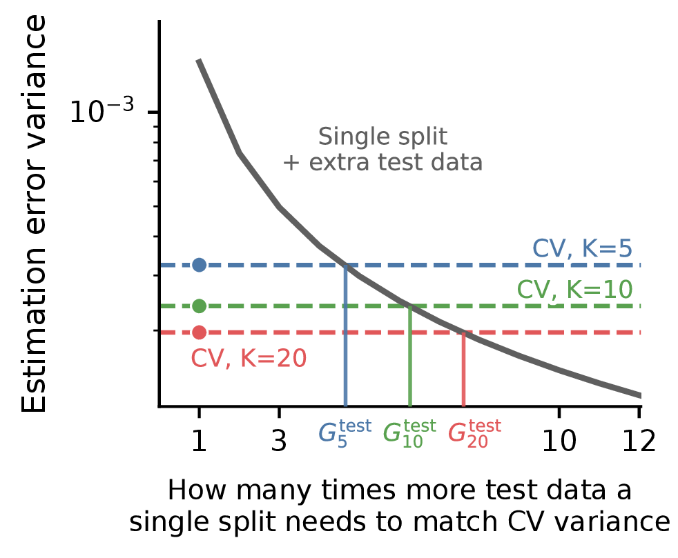

<div align="center">

# Crossing the Validation Crisis

### Cross-Validation Reduces Benchmarking Variance Surprisingly Well

**Célestin Eve · Gaël Varoquaux · Thomas Moreau**

*NeurIPS 2026, Evaluations and Datasets track*

[](https://arxiv.org/abs/2606.12552)
[](https://neurips.cc/)
[](LICENSE)
[](#quick-start)

</div>

## In a nutshell

When test data are scarce, a benchmark that relies on a single train/test split depends heavily on which examples
happened to be tested. Cross-validation repeats the split and averages. This repository measures what that buys.

- **A unit that speaks for itself.** The *variance-equivalent test sample gain* is how many times larger the test set of
  a single split would need to be to match the variance of $K$-split cross-validation.
- **Gains are large.** Up to about 15 after 200 splits in our simulations, and up to about 11 after 20 splits on real
  data (histopathology images and review classification).
- **They keep growing.** The gain is still rising well beyond the usual 5 or 10 splits.
- **The first splits tell you when to stop.** The *redundancy*, computed from the first few splits of one
  cross-validation run, anticipates whether more splits will pay off.

The practical message is simple: **split repeatedly**.

<p align="center">
  
</p>
<p align="center"><sub><b>Figure 2 of the paper.</b> The variance of a single split falls as its test set grows (grey curve).
Where it crosses the variance of K-split cross-validation (dashed lines) gives the sample gain G<sub>K</sub>:
here (MobileNetV2 on PatchCamelyon), 20 splits are worth a single split with a test set about 7.6 times larger.</sub></p>

## What is in this repository

| Folder | What it holds |
|---|---|
| [`simulated/`](simulated/) | the [benchopt](https://benchopt.github.io/) benchmark of the simulated experiments: data processes, learners, the configuration of every run, cluster launchers, and the analyses of the redundancy |
| [`pcam/`](pcam/) | the PatchCamelyon (histopathology) training loop, its run configurations and its analyses |
| [`yelp/`](yelp/) | the Yelp Review Full fine-tuning loops (BERT, XLM-RoBERTa, Qwen3-0.6B) and their run configurations |
| [`figures/`](figures/) | the scripts that draw every figure and compute every table of the paper from the outputs of the three experiments |
| [`cv_redundancy/`](cv_redundancy/) | a small helper to compute the redundancy in your own cross-validation (scikit-learn or PyTorch) and stop splitting once more splits would add little |

Each folder has its own README with its environment and instructions. The run outputs are not distributed: the
experiments produce them.

## Quick start

A one-seed simulated run, on a CPU, in a few minutes:

```bash
git clone https://github.com/soda-inria/crossing-the-validation-crisis
cd crossing-the-validation-crisis/simulated
pip install -r requirements.txt        # Python 3.11; pins benchopt 1.9.0
benchopt run . --config configs/preflight_derivation.yml --no-plot --no-cache --no-timeout -j 4
```

## Using the redundancy in your own cross-validation

[`cv_redundancy/`](cv_redundancy/) computes the redundancy after each split of a Monte Carlo cross-validation and
stops it once the splits left in the budget would add little sample gain, less than 10% by default (NumPy only;
scikit-learn and torch optional). From the repository root, or with it on `PYTHONPATH`:

```python
from sklearn.model_selection import ShuffleSplit
from cv_redundancy import cross_validate_until_redundant

res = cross_validate_until_redundant(estimator, X, y, cv=ShuffleSplit(n_splits=200, test_size=0.2),
                                     loss="squared_error")  # the per-sample loss of the metric of interest
print(res["n_splits"], res["monitor"])
```

Its [README](cv_redundancy/README.md) gives a runnable quick start, the PyTorch loop, the stopping rule and the caveats.

## Reproducing the paper

1. **Run the experiments**, following the README of each folder:
   - [`simulated/`](simulated/README.md): Python 3.11, CPU only;
   - [`pcam/`](pcam/README.md) and [`yelp/`](yelp/README.md): Python 3.12, one GPU per job.

   Each README lists the runs behind every figure and table. The paper's runs were made as SLURM job arrays on the
   Jean-Zay cluster (IDRIS), with the launchers of each folder.
2. **Gather the outputs under one data root** (layout below).
3. **Draw the figures and tables** with [`figures/`](figures/README.md) (Python 3.12), in the order its README gives.
   Each figure is written under the file name that the paper uses.

<details>
<summary><b>Where the scripts look for the run outputs</b></summary>

<br>

The figure and table scripts read the run outputs under one **data root**: the `--data-root` argument of the scripts
that take one, else the `DATA_ROOT` environment variable, else `data/` at the root of this repository
(`figures/code/datapaths.py`). Expected layout:

```
<data root>/
  outputs/        <config>__cNN.parquet: benchopt outputs of the chunked simulated runs (simulated/outputs/)
  merged/         <config>.parquet: python simulated/merge_chunks.py --in-dir simulated/outputs --out-dir <data root>/merged
  paper_runs/     benchopt_run_2026-05-04_12h45m52.parquet and benchopt_run_2026-07-*.parquet: single runs of
                  k200_study_rule_prospective_holdout_50.yml, config_hpo_test_*.yml and linear_1000_*.yml
                  (simulated/configs/README.md maps file names to configs)
  ranking/        benchopt_run_2026-05-31_05h37m39.parquet ... benchopt_run_2026-06-04_02h56m57.parquet: the 12 runs
                  of simulated/configs/ranking_*.yml
  pcam/
    results_output_pcam/  PCam K-split runs (pcam/configs/mccv_cnns.txt, mccv_vit.txt, repeated_kfold_cnns.txt)
    stratandnewmetrics/   PCam stratified and unstratified runs with Brier score and NLL
                          (pcam/configs/stratification*_newmetrics_full*.txt)
    ntr24/                PCam runs at n_tr = 24 (pcam/configs/redundancy_smalldata.txt), Appendix L
  nlp/
    yelp_qwen3_0.6b/            Qwen3-0.6B runs (yelp/configs/qwen_0.6b_1000.txt, qwen_0.6b_1000_nocv.txt)
    yelp_aligned/               BERT and XLM-RoBERTa on the PCam protocol (yelp/configs/aligned_bert.txt,
                                aligned_roberta.txt)
    yelp_runs_a/, yelp_runs_b/  first BERT and XLM-RoBERTa runs, January 2026 (optional, see below)
  mse_paper_figs/, holdout3_in/   inputs of two side scripts (figures/code/mse_gain_figures.py,
                                  figures/coherence_checks/rho_all.py)
```

Each sub-folder can be a link to wherever the outputs are. Three more locations, also set by environment variables:
`FIGS_DIR` (default `figs/` at the root) holds what the figure scripts write and the table scripts read back;
`PCAM_DIR` and `YELP_DIR` (default `pcam/` and `yelp/` of this repository) hold the outputs of the PCam analysis
scripts (`pcam/analysis/out_*/`) and the run outputs written next to the training scripts. The simulated analysis
scripts write to `simulated/analysis/out_<name>/`.

The paper no longer reports the first BERT and XLM-RoBERTa runs on Yelp, which used an earlier protocol, and their
run sets are not part of this repository. `regen_real_data_gain_figures.py` computes the Qwen3-0.6B rows of Figure 5 in
a pass that also reads them, and the bootstrap draws of one pass share a random stream. Without them, the Qwen3-0.6B
estimate on all seeds is unchanged and only its bootstrap draws differ, at the Monte Carlo level (95% interval at K =
20: [4.1, 9.8] instead of the published [4.3, 9.8]).

</details>

<details>
<summary><b>Every figure and table of the paper, with its runs and its script</b></summary>

<br>

Scripts are in `figures/` unless the path says otherwise; [figures/README.md](figures/README.md) gives the order in
which to run them and the file name under which each figure is written. Configurations are in `simulated/configs/`,
`pcam/configs/` and `yelp/configs/`; the simulated analysis scripts run from `simulated/`.

| Paper | Runs | Script |
|---|---|---|
| Figure 1 | no run: the OpenML dataset and task listings, which the script queries | `fig1_openml_sizes.py --out-dir ../figs/fig1 --cache ../figs/fig1/openml_listings.npz` (needs `openml` and network access unless the `--cache` file exists; OpenML changes over time, so a run today may differ slightly from the paper's figure) |
| Table 1, Figure 3 | (literature table, diagram) | none |
| Figure 2 | PCam K-split runs (`pcam/configs/mccv_cnns.txt`) | `fig2_pedagogical.py` (layout in `fig2_layouts.py`) |
| Figure 4, Figure 5 (left), Table E.1 | `paper_main_gain_mse_k200.yml`, `paper_main_gain_mse_k200_rff50.yml` | `paper_style_figs.py`; the three panels of Figure 5 share one axis in `fig5_common_axis.py`; intervals `ci_appendix.py` |
| Figure 5 (middle), Table E.2 | `pcam/configs/mccv_cnns.txt`, `mccv_vit.txt` | `regen_real_data_gain_figures.py --only fig5_pcam` |
| Figure 5 (right), Figure 7, Table E.2 | `yelp/configs/aligned_bert.txt`, `aligned_roberta.txt`; Qwen3-0.6B: `qwen_0.6b_1000.txt`, `qwen_0.6b_1000_nocv.txt` | `regen_real_data_gain_figures.py --only fig5_yelp_aligned` |
| Figure 6 | noise-injection grid `derivation_redundancy_levers_{shufflesplit,repeatedkfold,fixedsplit}.yml`; pre-registered holdout `k200_threshold_validation_holdout_50_*.yml`; unstable-learner designs `holdout2_largegain_*.yml`, `holdout3_largegain_*.yml`; PCam: `pcam/configs/redundancy_round3_50seeds_3sizes.txt`; Yelp: the aligned runs | `simulated/analysis/derivation_levers_analysis.py` then `simulated/analysis/omega_gain_relation.py` (tables in `simulated/analysis/out_omega/`); PCam tables: `pcam/analysis/pcam_gain_analysis.py` and `pcam/analysis/pcam_redundancy_vs_gain.py`; Yelp points `fig6_yelp_points.py`; figure `fig6_redundancy_vs_gain.py` |
| Figure D.1 | runs of Figure 4; `linear_1000_K20_new_unfixed.yml`, `paper_ntr100_k20_resampled_rff50.yml`; the PCam and Yelp runs of Figure 5 | `figD1_rho_delta.py` |
| Table D.1 | `k200_threshold_validation_holdout_50_*.yml`; fresh-seed confirmation `paper_rerun_may_design_*.yml` | from `simulated/`: gains `analysis/derivation_levers_analysis.py --loss neg_mse --glob '<data root>/outputs/k200_threshold_validation_holdout_50_*__c*.parquet' --out-dir analysis/out_holdout_mse`; then `analysis/redundancy_triage.py --gains-dir analysis/out_holdout_mse --out-dir analysis/out_redundancy_triage_holdout1` and `analysis/redundancy_triage_paper_outputs.py --dir analysis/out_redundancy_triage_holdout1` |
| Table D.2 | `pcam/configs/redundancy_round3_50seeds_3sizes.txt` | `pcam/analysis/pcam_gain_analysis.py`, `pcam/analysis/pcam_redundancy_vs_gain.py` |
| Appendix D.2, test-fraction check | `testsize_check_{regression,classification}.yml` | `simulated/analysis/testsize_factor_check.py` |
| Tables E.1 to E.8 | the runs of Figures 4, 5, G.1, H.1, I.1, J.1, K.1 and L.1 | `ci_appendix.py` (coverage check: `ci_coverage.py`) |
| Table F.2 | the runs above; `timing_*.yml` re-measure 5% of the July runs | `simulated/submit_timing.slurm`; `coherence_checks/yelp_times.py`, `coherence_checks/yelp_aligned_times.py` |
| Figure G.1, Tables G.1 and E.3 | `hpo_mse_MLP_gridsearch.yml`, `hpo_mse_MLP_randomsearch.yml`, `config_hpo_test_gridsearch.yml`, `config_hpo_test_randomsearch.yml` (ExtraTrees); fixed parameters from `paper_main_gain_mse_k200.yml` | `paper_style_figs.py`; redundancy `redundancy_numbers.py`, `simulated/analysis/paper_appendix_redundancy_checks.py`; text `text_numbers_v5.py` |
| Figure H.1, Table E.4 | `linear_1000_K20_new_fixed.yml`, `linear_1000_K20_new_unfixed.yml` (Ridge, ExtraTrees, MLP); `paper_ntr100_k20_fixed_redrawn_rff50.yml`, `paper_ntr100_k20_resampled_rff50.yml` (RandomFeatures) | `paper_style_figs.py`; standard-deviation ratios `sd_ratio_mse.py` |
| Figure I.1, Table E.5 | `pcam/configs/mccv_cnns.txt`, `repeated_kfold_cnns.txt` | `regen_real_data_gain_figures.py --only figF1` |
| Table J.1, Figure J.1, Table E.6 | `pcam/configs/stratification*_newmetrics_full*.txt` | `coherence_checks/strat_table.py` (Table J.1); `regen_real_data_gain_figures.py --only figK1` |
| Figure K.1, Table E.7 | the same PCam runs; for the text: `linear_1000_half1_K20_N1000.yml` (Ridge, R^2 and MSE), `paper_main_gain_mse_k200*.yml` (MAE), `pilot_persample_k20.yml` (R^2 recentred) | `regen_real_data_gain_figures.py --only figL1`; `appL_r2.py`, `text_numbers_v5.py`, `simulated/analysis/persample_r2_centering.py` |
| Figure L.1, Table E.8 | `linear_1000_half{1,2}_K20_smalldata{,2}.yml`, `small_budget_mlp64_rff50.yml`; PCam at n_tr = 24: `pcam/configs/redundancy_smalldata.txt` | `paper_style_figs.py`; text `text_numbers_v5.py`, `redundancy_numbers.py`, `coherence_checks/fold_geometry.py`, `coherence_checks/pcam24_*.py` |
| Table M.1 | PCam: `pcam/configs/mccv_cnns.txt` (every column; the single split is the first split of each run); Yelp: the aligned runs | PCam rows: `coherence_checks/g1_pcam_check.py`; Yelp rows: `code/nlp.py` via `regen_real_data_gain_figures.py --only fig5_yelp_aligned`, `coherence_checks/yelp_paper_snippets.py` |
| Table N.1 | `pcam/configs/mccv_cnns.txt` | `code/replicability.py` |
| Figure O.1 | `ranking_100seeds*.yml`, `ranking_100-300seeds*.yml`, `ranking_300-500seeds*.yml` | `code/ranking.py` |

Other numbers of the text come from `figures/coherence_checks/` (see its README), `redundancy_numbers.py` and
`text_numbers_v5.py`.

</details>

## Citation

```bibtex
@inproceedings{eve2026crossing,
  title     = {Crossing the Validation Crisis: Cross-Validation Reduces Benchmarking Variance Surprisingly Well},
  author    = {Eve, C{\'e}lestin and Varoquaux, Ga{\"e}l and Moreau, Thomas},
  booktitle = {Advances in Neural Information Processing Systems (NeurIPS), Evaluations and Datasets Track},
  year      = {2026}
}
```

## License

The code is released under the BSD 3-Clause license (see [LICENSE](LICENSE)). The datasets and pretrained models keep
their own terms: PatchCamelyon is released under CC0 1.0, Yelp Review Full under the Yelp Dataset Terms of Use
(non-commercial use only), and the pretrained checkpoints under their licenses (see [pcam/README.md](pcam/README.md)
and [yelp/README.md](yelp/README.md)). Neither the data nor the run outputs are redistributed here.
